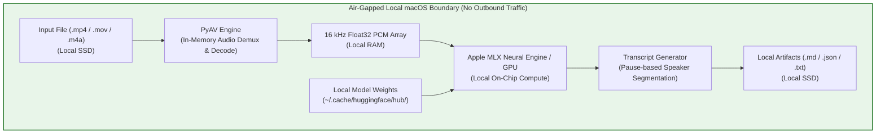

# Security & Privacy Audit: `transcribe-meeting` CLI Tool

**Document Purpose:** Enterprise Security, Compliance, and Data Privacy Assessment  
**Tool Name:** `transcribe-meeting` (alias `transcribe-video`)  
**Target Hardware:** Apple Silicon (Mac)  
**Execution Scope:** 100% On-Device / Local Processing  
**Status:** Air-Gapped Capable / Zero Remote Telemetry  

---

## 1. Executive Summary

The `transcribe-meeting` utility is a local command-line application designed to extract audio from video/audio recordings and transcribe them using Apple Silicon hardware acceleration. 

### Key Security Assertions
* **Zero Cloud Transmission:** At no point in the extraction, decoding, transcription, or formatting lifecycle are audio files, video files, transcripts, or meeting metadata transmitted across the network.
* **No Vendor Telemetry:** None of the core libraries or models contain analytics, telemetry, or user tracking.
* **Air-Gapped Operation:** All model weights and runtime libraries reside permanently in local storage (`~/.cache/` and `~/.local/`). The tool executes successfully with Wi-Fi disabled or in an air-gapped corporate network.

---

## 2. Architecture & Data Flow

All operations execute strictly within the local POSIX process space and macOS unified memory.



---

## 3. Software Bill of Materials (SBOM) & Component Audit

| Component | Author / Maintainer | License | Function | Network Activity |
| :--- | :--- | :--- | :--- | :--- |
| **`transcribe-meeting`** | Internal Script | Open / Internal | Command-line orchestration & parser | **None**. Local script. |
| **`av` (PyAV)** | PyAV Community / FFmpeg | LGPL / GPL 2.1+ | Local container demuxing & PCM audio decoding | **None**. Operates strictly on file buffers and memory. |
| **`numpy`** | NumPy Developers | BSD-3-Clause | Multi-dimensional array handling in RAM | **None**. Mathematical compute library. |
| **`mlx`** | Apple Inc. | MIT | Hardware-accelerated ML framework for Apple Silicon | **None**. Uses Metal Performance Shaders / GPU locally. |
| **`mlx-whisper`** | Apple / MLX Community | MIT | Whisper inference implementation for MLX | **None**. Local neural network execution. |
| **`whisper-large-v3-turbo`** | OpenAI / MLX Community | MIT | Passive binary model weights (1.61 GB static tensor files) | **None**. Read-only static weights file stored locally. |
| **`uv`** | Astral Software | MIT / Apache 2.0 | Ephemeral script runner / package manager | **None** when running cached scripts. |

---

## 4. Network & Telemetry Analysis

### 4.1 Dependency & Model Downloading (Initial Setup Only)
During first-time installation, packages are pulled via HTTPS from official package indices (PyPI) and model weights are pulled from Hugging Face (`huggingface.co`).

### 4.2 Runtime Isolation (Hardened Configuration)
To guarantee that no network communication occurs during runtime, the tool includes the following built-in environment flags:

```python
# Hardened offline enforcement configured at startup
os.environ.setdefault("HF_HUB_OFFLINE", "1")
os.environ.setdefault("TRANSFORMERS_OFFLINE", "1")
```

* **Effect:** Prevents `huggingface_hub` from initiating HTTP `HEAD` requests to verify model version freshness. The tool loads strictly from local disk cache without contacting external servers.

---

## 5. Security Recommendations for Corporate Data Handling

To maintain complete compliance with corporate data protection standards, adhere to the following operational best practices:

### 1. Guard Against Cloud Backup / Sync Services
* **Risk:** macOS default settings may automatically sync `~/Desktop` and `~/Documents` to **Apple iCloud Drive**. If confidential recordings or transcripts are placed in synced directories, macOS will upload them to iCloud.
* **Mitigation:**
  - Store meeting files and transcripts in un-synced directories (e.g., `~/Downloads`, a corporate-managed volume, or folders named with the `.nosync` extension, such as `~/Work.nosync/`).

### 2. Local Access Control & Permissions
* Output transcripts inherit the default umask of the user session. For sensitive financial or legal discussions, ensure the target folder permissions are restricted to the local user:
  ```bash
  chmod 700 /path/to/transcripts
  ```

### 3. Downstream LLM Ingestion
* **Risk:** While transcription is 100% on-device, pasting the resulting Markdown transcript into public or consumer AI interfaces (e.g., standard free tiers) may expose data to third-party model training.
* **Mitigation:** Only feed transcripts into organization-sanctioned LLM environments covered by Enterprise Business Associate Agreements (BAA) or Zero Data Retention (ZDR) terms.

---

## 6. How IT / InfoSec Can Independently Verify

Security teams can verify that no outbound traffic occurs during execution using standard network monitoring tools:

### Method A: Complete Air-Gap Test
1. Disconnect the Mac from all Wi-Fi, Ethernet, and VPN connections.
2. Execute the tool:
   ```bash
   transcribe-meeting "/path/to/sample_file.mp4"
   ```
3. Observe that execution completes successfully with full accuracy and zero network errors.

### Method B: Process Socket Audit
While `transcribe-meeting` is running, inspect active socket connections in another terminal window:
```bash
lsof -i -P | grep -i python
```
*Expected Result:* No open `ESTABLISHED` or `SYN_SENT` TCP/UDP sockets to remote IP addresses.
